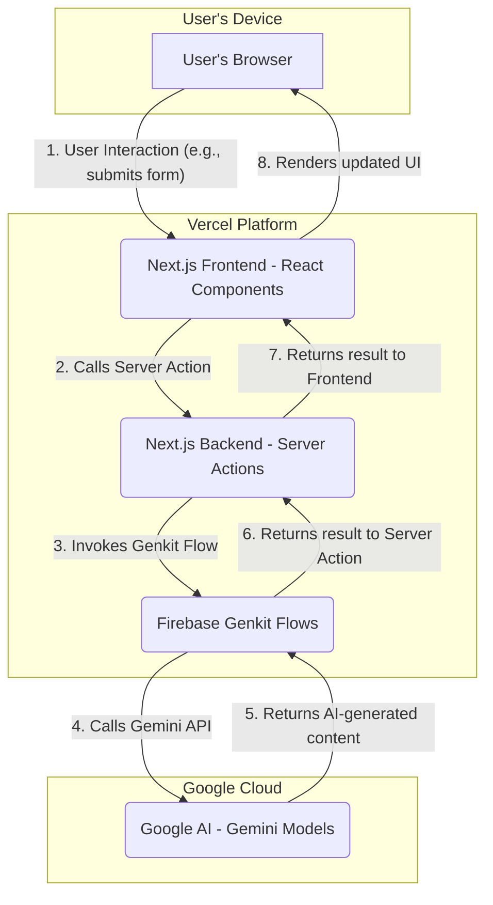

# Sahayak.AI Architecture Overview

This document outlines the technical architecture of the Sahayak.AI application, detailing the flow of data from the user to the backend services and back.

## Core Components

The application is built on a modern, serverless architecture that leverages the strengths of Next.js for the user interface and server-side logic, Genkit for AI orchestration, and Google AI for generative capabilities. The entire application is hosted on Vercel.

1.  **Client (Browser):** The user interacts with a responsive web interface built with Next.js and React.
2.  **Vercel:** A cloud platform that hosts the Next.js application, providing both the frontend hosting and the serverless backend environment.
3.  **Next.js (Frontend):** A React framework providing the user interface. It uses Server Components for fast initial loads and Client Components (with the `"use client";` directive) for interactivity. UI is built with ShadCN components and styled with Tailwind CSS.
4.  **Next.js (Backend - Server Actions):** Instead of traditional API endpoints, the frontend uses Next.js Server Actions. These are functions that run securely on the server and are directly callable from the client components. This simplifies the architecture by removing the need for a separate API layer.
5.  **Firebase Genkit (AI Orchestration):** Genkit is the core of the AI backend. It runs within the Vercel serverless environment. Genkit "flows" are defined as TypeScript functions that orchestrate calls to one or more AI models, handle data processing, and manage the logic for features like story generation, worksheet creation, etc.
6.  **Google AI (Gemini Models):** This is the underlying AI service. Genkit makes authenticated API calls to various Gemini models (e.g., Gemini 1.5 Flash for text, Gemini Pro Vision for image analysis) to get the generative content, which is then sent back through the flow.

---

## Architecture Diagram (Mermaid)

The following diagram illustrates the request/response flow:

### Data Flow Explained:

1.  **User Interaction:** A user performs an action on the website, such as filling out a form to generate a story and clicking "Generate".
2.  **Server Action Call:** The client-side React component calls an async Server Action function. This call is securely handled by Next.js.
3.  **Genkit Flow Invocation:** The Server Action, running on Vercel's backend, directly imports and invokes the relevant Genkit flow (e.g., `generateHyperlocalContent`).
4.  **Google AI API Call:** The Genkit flow makes a structured API call to the appropriate Google AI model (e.g., Gemini 1.5 Flash).
5.  **AI Response:** The Gemini model processes the prompt and returns the generated text or image data to the Genkit flow.
6.  **Flow Completion:** The Genkit flow processes the AI response (e.g., formats it as JSON) and returns it to the Server Action.
7.  **Response to Client:** The Server Action completes and returns the final data to the original calling component on the client.
8.  **UI Update:** The React component receives the data, updates its state, and re-renders the UI to display the new content to the user.
